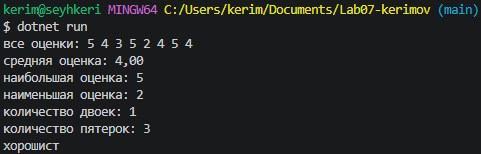
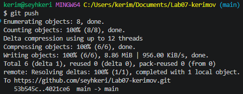

*Денис Александрович, здравствуйте. Столь быстрое выполнение данной лабораторной работы связано с тем, что я на сегодняшней паре уже ее выполнил, но на этой же паре у меня возникли определенные трудности с папкой img, ведь я ее забыл создать и соответственно мои скриншоты некуда было сохранять, но на самой паре я об этом еще не знал, ведь не дошел до выполнения readme. По приходу домой я это заметил, но скриншот с пушем  я уже физически сделать не мог, поэтому мною было принято решение сделать с "нуля"(видеоматериал прилагается(в папке img)). Спасибо за понимание.*
# Практическая работа №7

**ФИО:** Керимов Сейхан Заурбекович
**Группа:** ИСП-243
**Дата:** 13.10.2026

## Что изучено
 **Особенности индексации массивов:** Индексация элементов всегда начинается с нуля, а индекс последнего элемента равен длине массива минус единица (Length - 1). Обращение к несуществующему индексу вызывает ошибку IndexOutOfRangeException.
 **Использование цикла for:** Данный цикл необходим, когда в процессе перебора требуется изменять значения элементов массива по их индексу, так как через foreach элементы доступны только для чтения.
 **Применение цикла foreach:** Этот цикл намного удобнее и лаконичнее, когда нужно последовательно перебрать все элементы массива только для чтения значений, а сами числовые индексы в логике программы не используются.

## Скриншоты

